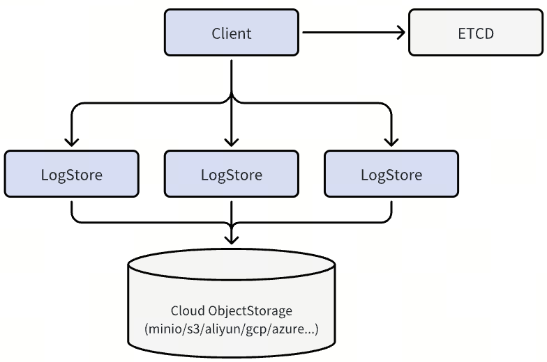

<p align="center"></p>

<h1 align="center">A Cloud-Native Write-Ahead Log Service</h1>

<p align="center">Ordered, durable logs built on object storage.<br>Deploy a replicated WAL service or embed the engine in your Go application.</p>

<p align="center">
  <a href="https://github.com/zilliztech/woodpecker/releases"></a>
  <a href="https://zilliztech.github.io/woodpecker/docs.html"></a>
</p>

<p align="center"><a href="https://zilliztech.github.io/woodpecker/">Website</a> · <a href="https://zilliztech.github.io/woodpecker/docs.html#quickstart">Quick Start</a> · <a href="https://zilliztech.github.io/woodpecker/docs.html#operations-cli">CLI Handbook</a> · <a href="https://zilliztech.github.io/woodpecker/docs.html#operations-scenarios">Troubleshooting</a> · <a href="https://github.com/zilliztech/woodpecker/releases">Releases</a></p>

Woodpecker provides ordered, durable logs for databases and stateful cloud applications. Service mode separates WAL processing from application compute: clients write to a quorum of LogStore nodes, active data is staged locally, and completed segments are compacted into object storage. Etcd provides metadata and coordination.

**Service mode is released, and Woodpecker is in an ongoing release cycle.** The next phase focuses on reliability, performance, operations, and observability. The current release is [v0.1.47](https://github.com/zilliztech/woodpecker/releases/tag/v0.1.47); check the release notes and integration requirements when selecting a version.

## Choose your deployment

| | Service mode | Embedded mode |
|---|---|---|
| Runs as | A dedicated LogStore cluster | A Go library inside your application |
| Write path | Quorum-based replication with local staging | In-process LogStore with the configured storage backend |
| Dependencies | LogStore nodes, etcd, object storage | Etcd and the configured storage backend |
| Fits | Applications that manage WAL infrastructure separately | Applications that prefer in-process integration |

<p align="center"></p>

Read the [architecture guide](https://zilliztech.github.io/woodpecker/docs.html#architecture) for both modes and the [quorum guide](https://zilliztech.github.io/woodpecker/docs.html#quorum) for replication and placement.

## Get started

### Run a local service cluster

Choose a complete walkthrough: [Kubernetes Service](https://zilliztech.github.io/woodpecker/docs.html#quickstart/kubernetes), [Docker Compose Service](https://zilliztech.github.io/woodpecker/docs.html#quickstart/service), or [Embedded library](https://zilliztech.github.io/woodpecker/docs.html#quickstart/embedded). Each path covers deployment, SDK configuration, application reads/writes, result verification, and cleanup.

For the Compose path, install Git and Docker with Compose v2.20+, then run from a current source checkout containing the tutorial files:

```bash
git clone --depth 1 https://github.com/zilliztech/woodpecker.git
cd woodpecker
docker compose -f docs/quickstart/compose.yaml --profile service up -d --wait --wait-timeout 180 etcd minio wp-0 wp-1 wp-2
docker compose -f docs/quickstart/compose.yaml build client
docker compose -f docs/quickstart/compose.yaml run --rm client --config /examples/compose-client.yaml
```

The development example pins the published v0.1.46 service image and runs the application on the same Docker network as the quorum nodes. Expect a `VERIFIED mode=service messages=1` line after the write/read check. The general [deployment guide](deployments/README.md) and [Operator guide](deployments/operator/README.md) cover other deployment/lifecycle configurations.

### Integrate the Go library

From your application's Go module:

```bash
go get github.com/zilliztech/woodpecker@v0.1.47
```

Use the Go version required by [go.mod](go.mod). The [SDK quick start](https://zilliztech.github.io/woodpecker/docs.html#quickstart/embedded) covers storage configuration, client creation, and log reads/writes. Embedded mode still requires etcd and its configured storage backend.

### Write and read a log

This embedded-mode example uses the etcd and MinIO endpoints exposed by the local Compose environment above; it does not use the LogStore service nodes. In a separate Go module, install the library as shown above and save the following as `woodpecker.yaml` (adjust endpoints and credentials for your environment):

```yaml
woodpecker:
  storage:
    type: minio
etcd:
  endpoints: ["127.0.0.1:12379"]
  rootPath: readme-example
minio:
  address: 127.0.0.1
  port: 19000
  accessKeyID: minioadmin
  secretAccessKey: minioadmin
  useSSL: false
  bucketName: woodpecker-readme-example
  rootPath: wal
  createBucket: true
```

Save this as `main.go`. It creates a log, writes one message synchronously, reads that message from its returned position, and closes the resources:

```go
package main

import (
	"context"
	"fmt"
	"log"
	"time"

	"github.com/zilliztech/woodpecker/common/config"
	"github.com/zilliztech/woodpecker/woodpecker"
	wplog "github.com/zilliztech/woodpecker/woodpecker/log"
)

func main() {
	if err := run(); err != nil {
		log.Fatal(err)
	}
}

func run() error {
	ctx, cancel := context.WithTimeout(context.Background(), 30*time.Second)
	defer cancel()

	cfg, err := config.NewConfiguration("woodpecker.yaml")
	if err != nil {
		return err
	}
	client, err := woodpecker.NewEmbedClientFromConfig(ctx, cfg)
	if err != nil {
		return err
	}
	defer client.Close(context.Background())

	// A new log name makes the example safe to run more than once.
	name := fmt.Sprintf("hello-wal-%d", time.Now().UnixNano())
	if err := client.CreateLog(ctx, name); err != nil {
		return err
	}
	handle, err := client.OpenLog(ctx, name)
	if err != nil {
		return err
	}
	defer handle.Close(context.Background())

	writer, err := handle.OpenLogWriter(ctx)
	if err != nil {
		return err
	}
	defer writer.Close(context.Background())
	result := writer.Write(ctx, &wplog.WriteMessage{Payload: []byte("hello, Woodpecker")})
	if result.Err != nil {
		return result.Err
	}

	// Start at the position returned by the successful write.
	reader, err := handle.OpenLogReader(ctx, result.LogMessageId, "readme-example")
	if err != nil {
		return err
	}
	defer reader.Close(context.Background())
	message, err := reader.ReadNext(ctx)
	if err != nil {
		return err
	}
	fmt.Println(string(message.Payload)) // hello, Woodpecker
	return nil
}
```

Run `go mod tidy` and `go run .` from that module. Among the runtime logs, the program prints `hello, Woodpecker`. Each run creates a separate example log and retains its data.

For asynchronous writes, replace the synchronous write with:

```go
result := <-writer.WriteAsync(ctx, &wplog.WriteMessage{Payload: []byte("hello, Woodpecker")})
if result.Err != nil {
    return result.Err
}
```

Service mode uses the same log/writer/reader API after client creation. Its client additionally needs the service storage configuration, an etcd client, and reachable advertised LogStore addresses; see the [service client example](https://zilliztech.github.io/woodpecker/docs.html#quickstart/service). The SDK config above is separate from the operational CLI's `cli.yaml`.

### Install the operational CLI

Download the binary for your OS and architecture from [Releases](https://github.com/zilliztech/woodpecker/releases/tag/v0.1.47). For example, on macOS with Apple Silicon:

```bash
mkdir -p "$HOME/.local/bin"
curl -fL https://github.com/zilliztech/woodpecker/releases/download/v0.1.47/wp-darwin-arm64 \
  -o "$HOME/.local/bin/wp"
chmod +x "$HOME/.local/bin/wp"
export PATH="$HOME/.local/bin:$PATH"
wp version
```

Linux binaries are `wp-linux-amd64` and `wp-linux-arm64`; Windows uses `wp-windows-amd64.exe`. To build from a checkout instead, run `make wpcli` and use `./bin/wp`. The [CLI setup guide](https://zilliztech.github.io/woodpecker/docs.html#operations-cli-local) explains `cli.yaml`, etcd connections, and node address mappings for access from outside Kubernetes.

## Operate and troubleshoot

| Goal | Tools and documentation |
|---|---|
| Check cluster and node health | `wp cluster health`, `wp node log-health` — [cluster status](https://zilliztech.github.io/woodpecker/docs.html#operations-cli-cluster) |
| Investigate slow or stalled work | `wp ops`, `wp metrics report`, `wp profile` — [runtime diagnostics](https://zilliztech.github.io/woodpecker/docs.html#operations-cli-ops) |
| Compare metadata and replica data | `wp log scan`, `wp segment inspect/probe`, `wp meta check` — [segment diagnosis](https://zilliztech.github.io/woodpecker/docs.html#operations-cli-segment) |
| Correct known metadata problems | `wp meta` preview/apply with revision checks, backup, and audit — [metadata repairs](https://zilliztech.github.io/woodpecker/docs.html#operations-cli-meta) |
| Manage read progress and retention | `wp log readers`, `wp log skip-range`, `wp log truncate` — [log operations](https://zilliztech.github.io/woodpecker/docs.html#operations-cli-log) |

Start from the symptom: [read stalls](https://zilliztech.github.io/woodpecker/docs.html#operations-scenarios-read), [write stalls](https://zilliztech.github.io/woodpecker/docs.html#operations-scenarios-write), or [data corruption and recovery](https://zilliztech.github.io/woodpecker/docs.html#operations-scenarios-corruption). Metadata consistency, physical data coverage, and application recovery are separate checks; each guide explains what its results establish.

Prometheus metrics and OpenTelemetry tracing support monitoring and diagnosis. See [monitoring](https://zilliztech.github.io/woodpecker/docs.html#monitoring) for configuration.

## Development direction

With the service architecture in place, development focuses on:

- **Reliability:** failure testing, recovery behavior, and lifecycle transitions.
- **Performance:** throughput, tail latency, and resource efficiency.
- **Operations:** diagnosis, controlled repairs, and maintenance workflows.
- **Observability:** actionable metrics, tracing, and runtime visibility.

See [open issues](https://github.com/zilliztech/woodpecker/issues) for ongoing work. Evaluate performance with the [benchmark tooling](tests/benchmark) using your own workload, hardware, durability policy, and deployment mode.

## Contribute

Bug reports, reproducible performance findings, documentation improvements, and pull requests are welcome. Check [existing issues](https://github.com/zilliztech/woodpecker/issues) before opening a new one, and see [build instructions](build/README.md) to get started.

Use [issue and pull request commands](.github/ISSUE_COMMANDS.md) to claim an issue with `/assign`, release your assignment with `/unassign`, or manage milestones with `/set-milestone` (repository write access required).

## License

- **Server components** (`server/`): your choice of AGPLv3 or SSPLv1, as described in [server/LICENSE](server/LICENSE).
- **Other components:** [Apache License 2.0](APACHE-LICENSE-2.0.txt).

See [LICENSE.txt](LICENSE.txt) for details.
